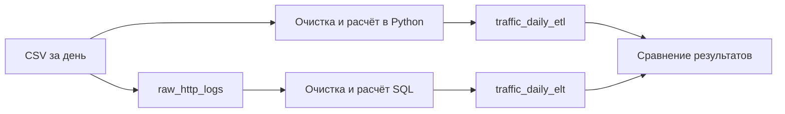

# http-traffic-pipeline

Учебный проект для сравнения ETL и ELT на синтетических HTTP-логах. По каждому дню и адресу страницы рассчитываются количество запросов, уникальные IP, ответы 4xx и 5xx, доля ошибок и среднее время ответа.

Одинаковые данные проходят две ветки одного DAG в Airflow. В ETL очистка и расчёты выполняются в Python до загрузки результата. В ELT исходные строки сначала загружаются в ClickHouse, затем обрабатываются SQL. В конце DAG сравнивает показатели двух витрин.

Стек: Python 3.11, Airflow 2.11.0, ClickHouse 25.8.1.5101, clickhouse-connect 0.9.2 и Docker Compose.

## Обработка



Из записей удаляются полные дубли, пустые обязательные поля, некорректные статусы и отрицательное время ответа. Дата события должна совпадать с датой файла. Из path убираются query-параметры. Правила одинаковы в обеих ветках.

| Таблица | Содержимое |
| --- | --- |
| `raw_http_logs` | Исходные значения как строки и дата файла `source_date` |
| `traffic_daily_etl` | Показатели, рассчитанные в Python |
| `traffic_daily_elt` | Показатели, рассчитанные в ClickHouse |

Таблицы используют MergeTree и месячные партиции `toYYYYMM`. Ключ витрин `(event_date, path)` соответствует запросам по дате и странице. Raw-таблица сортируется по `(source_date, path, request_id)`. При повторном запуске заменяются только данные выбранного дня.

Уникальные IP не равны пользователям. Их нельзя складывать между страницами и днями. В SQL используются `count`, `countIf`, `uniqExact` и `avg`.

## Данные

Демонстрационные данные синтетические. Готовые CSV лежат в `data/raw`: 20 000 строк за 30 января - 2 февраля 2025 года. В них есть дубли, некорректные числа и отрицательное время ответа.

Пример результата за 30 января:

| path | requests | unique_ips | errors_4xx | errors_5xx | error_rate | avg_response_ms |
| --- | ---: | ---: | ---: | ---: | ---: | ---: |
| / | 1169 | 199 | 119 | 53 | 0.147134 | 358.426869 |
| /catalog | 1479 | 200 | 140 | 79 | 0.148073 | 355.992265 |

## Запуск и проверка

Команды выполняются в корне проекта:

```bash
cp .env.example .env
docker compose up -d --build --wait --wait-timeout 300
docker compose exec airflow airflow dags test http_traffic_pipeline 2025-01-30 --conf '{"process_date":"2025-01-30"}'
```

Успешный запуск завершается статусом `success`. Последняя задача выводит `ETL = ELT` и 7 групп страниц. Чтобы проверить повторную загрузку, выполните команду запуска DAG ещё раз: количество групп и показатели должны остаться прежними. Для другого дня поменяйте `process_date` и дату в команде.

Посмотреть витрину и выполнить аналитические запросы:

```bash
docker compose exec clickhouse clickhouse-client --user traffic --password local_demo_password --query "SELECT * FROM traffic.traffic_daily_etl ORDER BY event_date, path LIMIT 10"
docker compose exec clickhouse clickhouse-client --user traffic --password local_demo_password --multiquery --queries-file /sql/analytics.sql
docker compose exec clickhouse clickhouse-client --user traffic --password local_demo_password --param_process_date=2025-01-30 --queries-file /sql/explain.sql
```

Пароль в командах соответствует `.env.example`. Airflow доступен на http://localhost:8080, логин `admin`. Пароль можно получить командой `docker compose exec airflow cat /opt/airflow/standalone_admin_password.txt`. Порты и параметры сборки задаются в `.env`.

В `analytics.sql` есть посещаемость страниц, доля ошибок, статистика за диапазон дат и активные части таблиц. EXPLAIN показывает отбор частей по дате и гранул по ключу сортировки. После обработки четырёх дней в проверке MinMax оставил одну из четырёх частей; фильтр path не исключил дополнительные гранулы на маленькой витрине.
